# Packing Tool — Ръководство

## Част 1 — Ежедневна работа

### 1. Какво прави Packing Tool

Packing Tool е мястото, където опаковате поръчките от списък за опаковане. Fulfilment прави списъците за опаковане за всеки клиент. Вие не ги правите тук.

Стъпките са:

1. Fulfilment прави списъка за опаковане и го записва в папката `packing_lists` на сесията.
2. Packing Tool показва списъка в **Сесии**.
3. Вие започвате сесията. Отваря се режим „Опаковчик“ и сканирате всяка поръчка и всеки артикул.
4. Когато списъкът е готов, приключвате сесията. Packing Tool записва отчет.

### 2. Стартиране на приложението и избор на работник

1. Отворете **Packing Tool**. Заглавието на прозореца и страничната лента казват **Packer Assistant**. Първият екран казва **Изберете своя профил**.
2. Натиснете вашето име. Картата казва **Отваря се…** за малко, после се отваря страницата **Опаковане**.
3. Ако името ви не е в списъка, натиснете **Нов работник**, въведете името си и натиснете **Създай**.
4. За да затворите приложението от този екран, натиснете **Изход**. Когато сте вътре, натиснете **Смени работника…** в долната част на страничната лента, за да изберете друг работник.

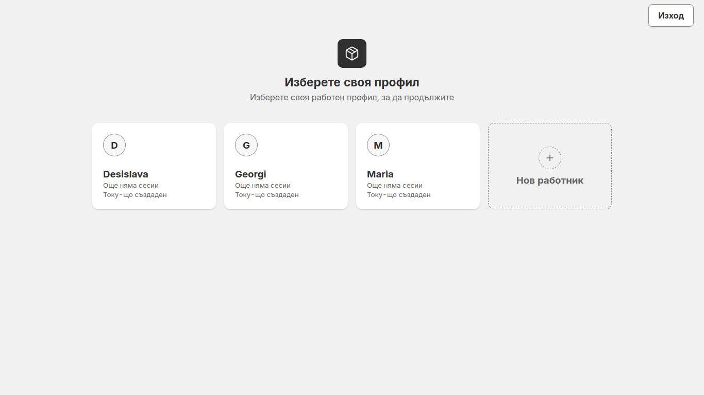

В долната част на страничната лента се виждат връзката, езикът и темата:

- **Свързан със сървъра**, с пътя до файловия сървър, означава, че този компютър може да достигне сървъра. Ако пише **Няма връзка със сървъра**, вижте раздел 12.
- Натиснете **EN** или **BG**, за да смените езика. Натиснете **Светла** или **Тъмна**, за да смените темата.

### 3. Отваряне на сесия и започване на опаковане

Сесия е един списък за опаковане за един клиент.

1. Изберете клиента в полето горе вляво в прозореца.
2. Натиснете **Отвори сесия**. Отваря се страницата **Сесии**.
3. Намерете сесията, която ви трябва. Сесия, която още никой не е опаковал, показва **Не е започната**.
4. Щракнете два пъти върху сесията. Можете и да я изберете и после да натиснете **Започни опаковане** в панела вдясно.
5. Режим „Опаковчик“ се отваря и казва **Сканирайте баркода на поръчка**.

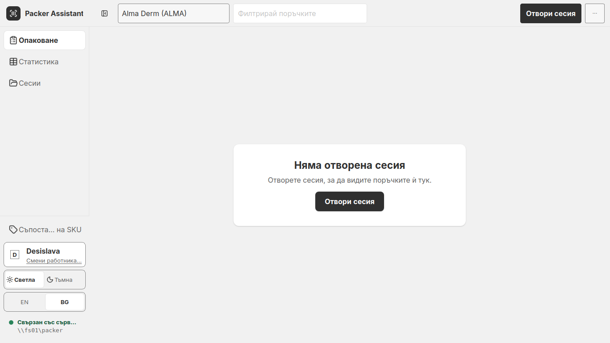

### 4. Опаковане на поръчка

В режим „Опаковчик“ има една отворена поръчка наведнъж. Сканирайте първо поръчката, после нейните артикули.

1. Сканирайте баркода на поръчката. Скенерът въвежда в полето **Поръчка или SKU**. Ако въвеждате номера сами, натиснете Enter.
2. Поръчката се отваря. Всеки ред с артикул показва състоянието си — **Предстои**, **Частично** или **Готово** — и колко бройки са опаковани.
3. Сканирайте баркода на всеки артикул. Всяко сканиране опакова една бройка. Банерът казва какво е станало, например **01-FACE-1006 е потвърден — опаковани 1 от 1**.
4. Когато всеки ред е готов, банерът казва **Поръчка 100002161 е опакована. Сканирайте следващата поръчка.** Сканирайте следващата поръчка.
5. Точката до кутията казва **Готов за сканиране**. Тя казва **Сканерът е изключен**, когато сканирането е спряно, например докато има отворен въпрос.

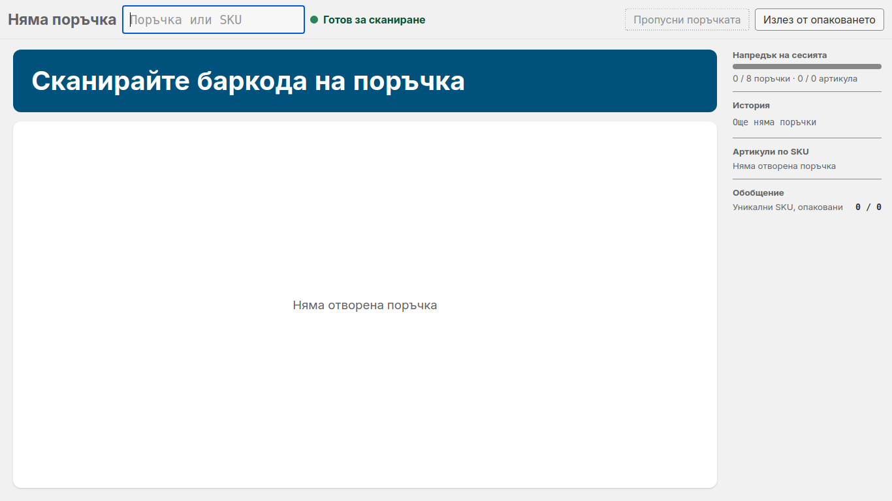

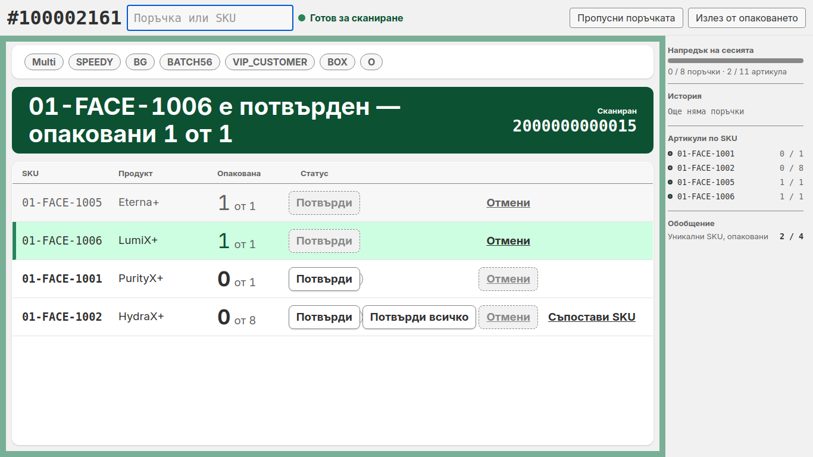

### 5. Ръчно потвърждение, отмяна и „Потвърди всичко“

Някои артикули не могат да се сканират. Използвайте бутоните в края на реда на артикула.

- **Потвърди** опакова една бройка без сканиране. Използвайте го само когато баркодът не може да се сканира.
- **Отмени** връща една бройка назад. Бутонът е изтъмнен, когато на този ред нищо не е опаковано.
- **Потвърди всичко** опакова наведнъж всички останали бройки на реда. Появява се само на редове с повече от 5 бройки. Приложението пита първо, с въпрос **Потвърди всичко** и броя на бройките. Натиснете **Потвърди всичко**, за да се съгласите, или **Отказ**, за да спрете. Скенерът е изключен, докато не отговорите. Приложението казва, че не може да се отмени.

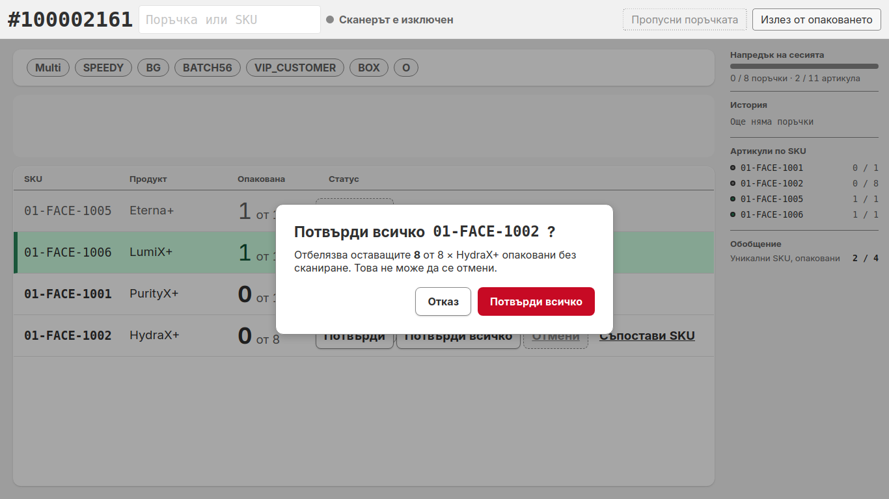

> **Важно:** Използвайте **Потвърди всичко** само когато бройките наистина са в поръчката. Не можете да ги върнете.

Бутон **Съпостави SKU** на ред означава, че към този SKU още няма свързан баркод. Вижте част 2, Съпоставяне на SKU от режим „Опаковчик“.

### 6. Допълнителен и Няма съвпадение

Две предупреждения си приличат, но означават различни неща.

**Допълнителен** означава, че артикулът е в тази поръчка, но всичките му бройки вече са опаковани, а вие сте го сканирали отново.

1. Банерът казва **Сканиран е допълнителен артикул — запазете го или го премахнете**. Жълт панел, **Сканирани допълнителни артикули**, показва SKU с думата **Допълнителен** и броя.
2. Натиснете **Запази**, ако бройката наистина е от тази поръчка. Натиснете **Премахни**, ако сте я сканирали по погрешка.
3. Всяко натискане премахва една бройка. Приложението пази само броя, не кой бутон сте натиснали.
4. Поръчката не се затваря, докато остане допълнителен артикул. Банерът казва **Прегледайте допълнителните артикули, преди да може да се затвори тази поръчка**.

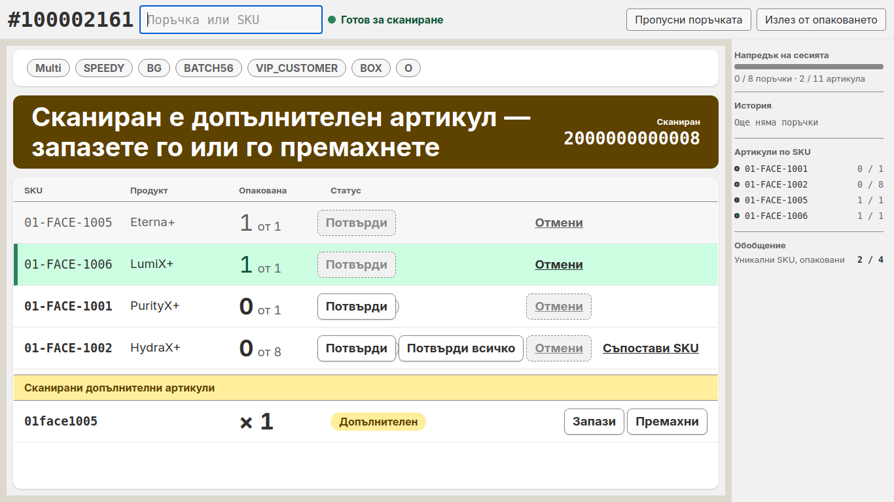

**Няма съвпадение** означава, че баркодът не е артикул от тази поръчка и съпоставянето на SKU не го превръща в такъв. Банерът казва **Непознат SKU 0000000000000 — сканирайте отново или го съпоставете**, а сканирането се появява като ред, маркиран с **Няма съвпадение**, с текста **Не е SKU или баркод, който този клиент познава**.

1. Погледнете артикула. Ако е грешен артикул или артикул от друга поръчка, отделете го настрани.
2. Ако е артикул от тази поръчка, но баркодът му не е в съпоставянето, натиснете **Съпостави баркод…** на реда. Добавете баркода според частта за съпоставяне от режим „Опаковчик“ в част 2. После сканирайте артикула отново.

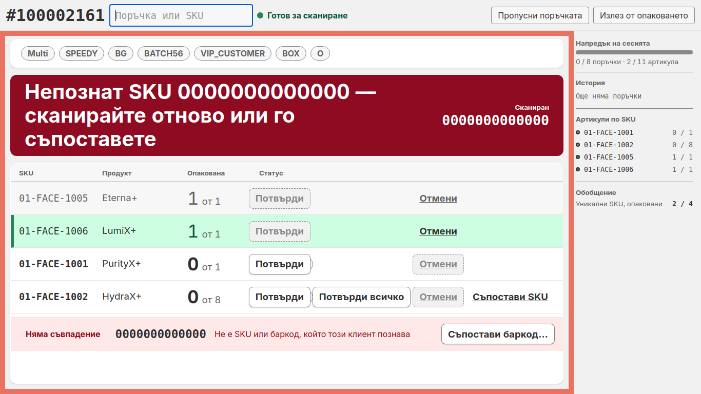

### 7. Пропускане на поръчка и приключване на сесията

1. Ако една поръчка не може да се завърши сега, натиснете **Пропусни поръчката**. Поръчката отива в историята като **Пропусната**. Бройките, които вече сте опаковали в нея, се запазват, и можете да сканирате следващата поръчка.
2. Сканирайте отново пропусната поръчка, когато можете да я завършите. Тя се опакова както обикновено.
3. Когато всички поръчки са опаковани, панелът казва **Сесията е завършена** с общите суми, например „5 от 5 поръчки опаковани, 17 артикула.“, и предлага **Приключи сесията** и **Излез от опаковането**.
4. Натиснете **Приключи сесията** или натиснете Ctrl+E. Packing Tool записва отчет в папката `reports` на сесията и затваря сесията.

> **Забележка:** Можете да приключите сесия, преди всички поръчки да са опаковани. Тогава сесията се записва като **Незавършена**.

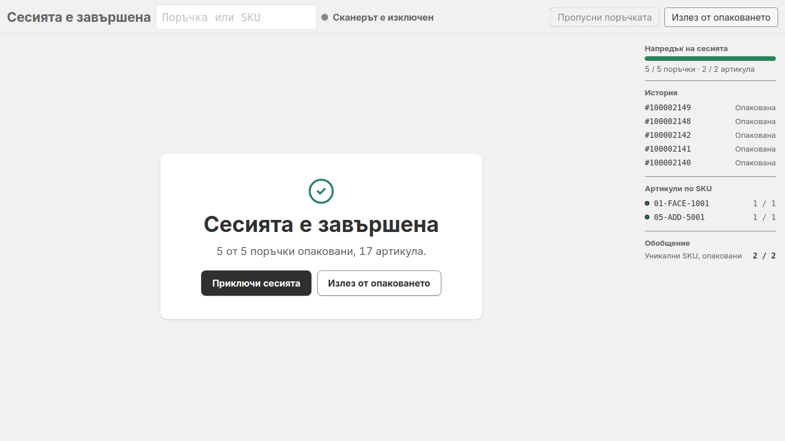

### 8. Излизане, връщане и поемане

1. Натиснете **Излез от опаковането**, за да се върнете на страницата **Опаковане**. Сесията остава отворена. Поръчките, които сте опаковали, се запазват.
2. За да се върнете в режим „Опаковчик“, натиснете **Започни опаковане** в горната част на страницата **Опаковане**.
3. На този компютър може да е отворена само една сесия. За да отворите друга, първо натиснете **Приключи сесията**.
4. Ако друг компютър поеме списъка, докато опаковате, страницата казва **Списъкът е отворен на друг компютър**. Сканерът спира. Натиснете **Излез от опаковането**. Поръчките, които сте опаковали тук до момента, се запазват.
5. Сесия показва **Застояла** в списъка **Сесии**, когато компютърът, който я е държал, не е отговорил две минути. Щракнете два пъти върху сесията. Приложението пита **Поеми** и името на сесията. Натиснете **Поеми и продължи**, само когато другият компютър наистина е спрял. Натиснете **Отказ**, за да оставите сесията на мира.

### 9. Статистика

**Статистика** показва числата за отворения списък.

- Горният ред показва **Поръчки**, **Завършена**, **Артикули**, **Уникални SKU** и **Напредък**.
- **По куриер** показва колко поръчки са готови за всеки куриер.
- **Обобщение по SKU** показва всеки SKU с **Общо количество**, **Опакована** и **Оставащи**. Колоната **Статус** казва **Предстои**, **Частично** или **Опакована**.

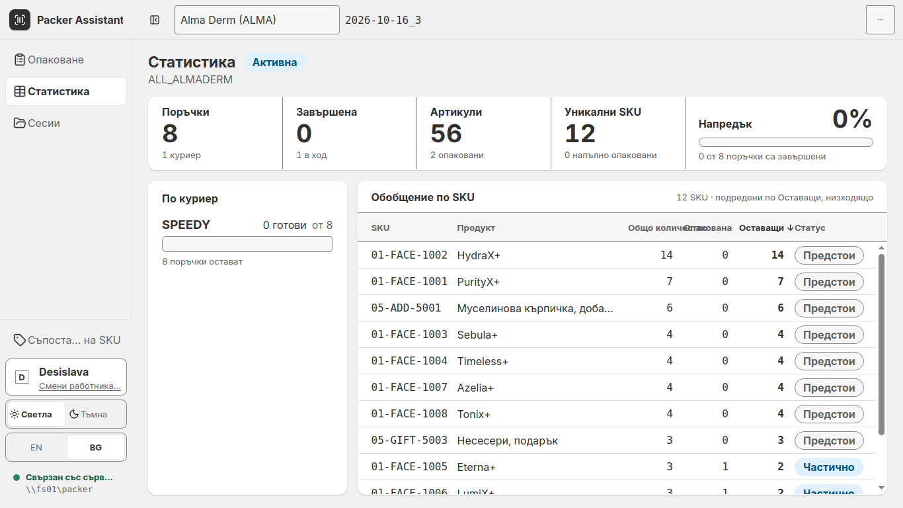

### 10. Сесии и подробности за сесията

1. Натиснете **Сесии** в страничната лента.
2. Използвайте разделите **Всички**, **Отвори**, **Приключени** и **Изоставена**, за да филтрирате списъка. За да намерите сесия, пишете в полето **Търсене**.
3. Колоната **Статус** показва **Не е започната**, **Активна**, **Паузирана**, **Застояла**, **Завършена**, **Незавършена** или **Изоставена**. Сесията е **Завършена**, когато всички поръчки са опаковани. Тя е **Незавършена**, когато е приключена преди това.
4. Легендата в долната част казва **Зададено от човек** за плътна точка и **Определено от системата** за празна точка.
5. Щракнете два пъти върху приключена сесия или я изберете и натиснете **Виж подробностите**. Страницата с подробности показва **Работник**, **Компютър**, времената и броенията: **Опаковани поръчки**, **Опаковани артикули** и **Пропуснати поръчки**.
6. За да запазите подробностите като файл на Excel, натиснете **Експорт в Excel**. За да се върнете, натиснете **Назад към сесиите**.

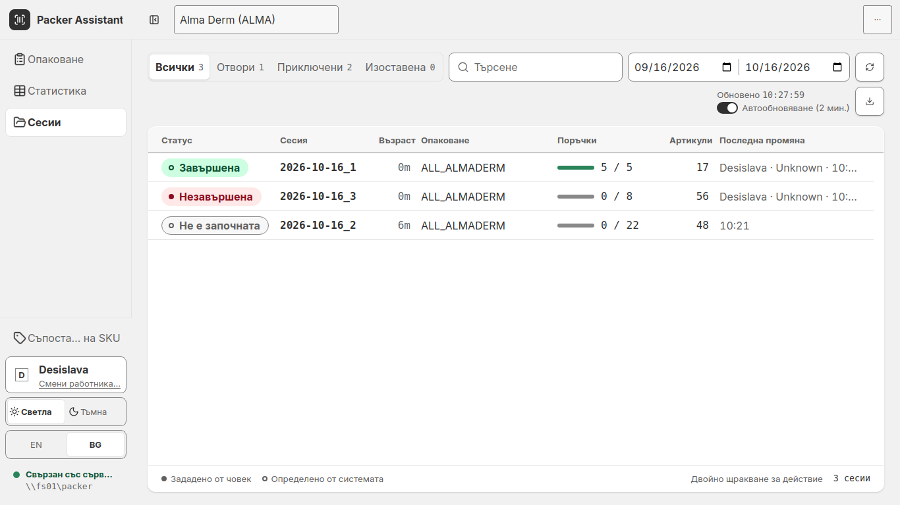

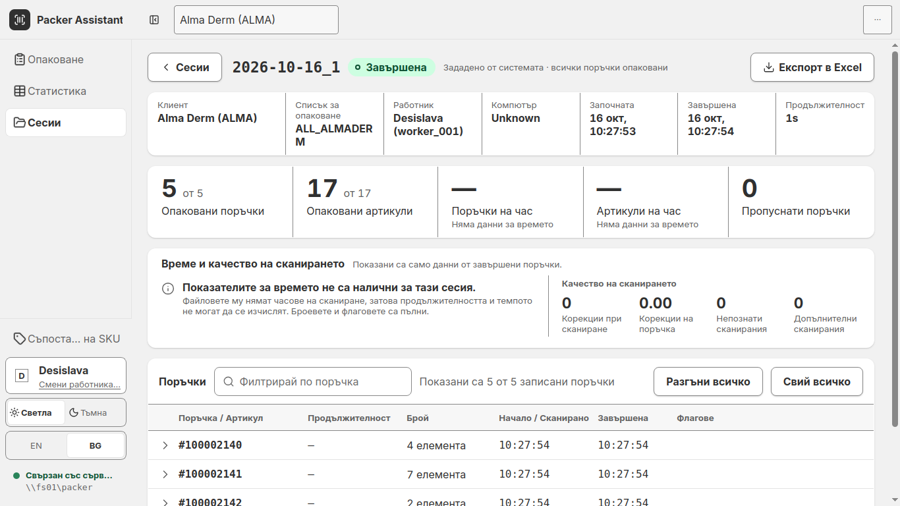

### 11. Език, тема и актуализации

- Натиснете **EN** или **BG** в долната част на страничната лента, за да смените езика.
- Натиснете **Светла** или **Тъмна**, за да смените темата.
- Натиснете ⋯ горе вдясно на страницата **Опаковане**, **Статистика** или **Сесии**. Менюто има **Ръководство**, **Връзка със сървъра…**, **Провери за актуализации…** и **Изход**.
- Натиснете **Ctrl+1** за **Опаковане**, **Ctrl+2** за **Статистика** и **Ctrl+3** за **Сесии**.

### 12. Когато нещо се обърка

Всяко съобщение по-долу е текстът, който показва приложението.

#### Няма връзка със сървъра

Банерът казва **Няма връзка със сървъра**, с пътя до сървъра и часа, в който е спрял да отговаря. **Сесиите не могат да се отварят или приключват, докато не отговори.**

1. Натиснете **Опитай отново**.
2. Ако пак не успее, натиснете ⋯, после **Връзка със сървъра…**, и проверете пътя.
3. Ако пак не успее, попитайте човека, който се грижи за сървъра.

#### Напредъкът не е запазен — проверете мрежата

Банерът **Напредъкът не е запазен — проверете мрежата** означава, че приложението не е могло да запише напредъка ви на файловия сървър. **Сканирането продължава**, но напредъкът все още не е на сървъра.

1. Продължете със сканирането и проверете мрежата.
2. Ако банерът остане, кажете на човека, който се грижи за сървъра. Той изчезва, когато запазването отново работи.

#### Списъкът е отворен на друг компютър

Друг компютър е поел списъка. Натиснете **Излез от опаковането**. Поръчките, които сте опаковали тук до момента, се запазват. Вижте раздел 8.

#### Поръчка 100002149 вече е опакована

Поръчката е опакована преди. Не я опаковайте отново. Сканирайте следващата поръчка.

#### Няма поръчка, която да съответства на 123

Номерът, който сканирахте, го няма в този списък за опаковане. Проверете го и го сканирайте отново.

#### 100002150 е поръчка. Първо завършете или пропуснете 100002161.

Сканирали сте друга поръчка, докато има отворена. Завършете отворената поръчка или натиснете **Пропусни поръчката**, и после сканирайте новата.

#### 2026-10-16_3 е отворена на този компютър. Приключете я, преди да отворите друга.

На този компютър може да е отворена само една сесия. Натиснете **Приключи сесията** и после отворете другата сесия.

---

## Част 2 — Настройка

### Работници

1. На първия екран натиснете **Нов работник**, въведете име в полето и натиснете **Създай**. Името може да е до 24 знака.
2. Приложението не приема име с тези съобщения:
   - **Въведете име.** Полето е празно.
   - **Използвайте букви, цифри, интервали, точки, тирета или апострофи.** Името има други знаци.
   - **Вече има работник на име Maria. Изберете тази карта или добавете фамилно име.** Работник с това име вече съществува. Сравнението не отчита главните и малките букви.

### Съпоставяне на SKU

Съпоставянето свързва баркод на артикул с вътрешния SKU от списъка за опаковане. Когато сканирате съпоставен баркод, Packing Tool го брои като този SKU. Съпоставянията се записват на файловия сървър и всеки компютър ги използва.

1. Натиснете **Съпоставяне на SKU** в долната част на страничната лента.
2. Натиснете **Добави съпоставяне**. Сканирайте или въведете баркода на артикула в **Сканирайте или въведете баркод**, после въведете SKU в **Вътрешен SKU**. Натиснете **Добави**.
3. За да промените съпоставяне, натиснете иконата с молив, **Редактирай**. За да премахнете съпоставяне, натиснете иконата с кошче, **Изтрий**, и потвърдете.
4. Използвайте **Търсене по баркод или SKU**, за да намерите съпоставяне.
5. Натиснете **Запази**. Страницата казва **Запазено. Всички компютри вече използват тези съпоставяния.** Докато не запазите, страницата показва **Незапазени:** с броя промени.
6. За да отхвърлите промените си и да заредите копието от сървъра, натиснете **Презареди от сървъра**, после **Отхвърли и презареди**.
7. За да излезете с незапазени промени, натиснете **Отказ**. Приложението пита **Да се отхвърлят незапазените промени?**. Натиснете **Продължи редактирането**, за да останете, или **Отхвърли**, за да излезете.

Ако баркодът вече е свързан с друг SKU, страницата показва **Този баркод вече е свързан със** този SKU и не го добавя.

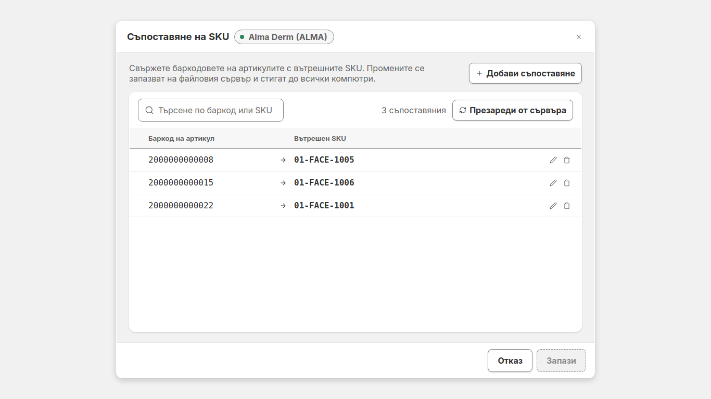

Ако файловият сървър не може да се достигне, страницата показва **Не можа да се запази на файловия сървър.** Промените ви остават на страницата. Натиснете **Опитай отново**. Ако списъкът не може да се прочете, страницата казва **Съпоставянията не можаха да се заредят.** Натиснете **Опитай отново**.

### Съпоставяне на SKU от режим „Опаковчик“

Използвайте това, когато сканирането няма съпоставяне. Страницата се отваря над режим „Опаковчик“, а добавянето се запазва веднага.

1. На ред за артикул с бутон **Съпостави SKU** натиснете него. SKU се попълва и не може да се променя. Сканирайте или въведете баркода на артикула, после натиснете **Добави**.
2. На ред **Няма съвпадение** натиснете **Съпостави баркод…**. Баркодът се попълва и не може да се променя. Въведете SKU или го изберете от редовете по-долу. Ако SKU го няма в тази поръчка, страницата казва **Няма го в тази поръчка. Изберете един от редовете по-долу.**
3. Натиснете **Назад към опаковането**, за да излезете без промяна.

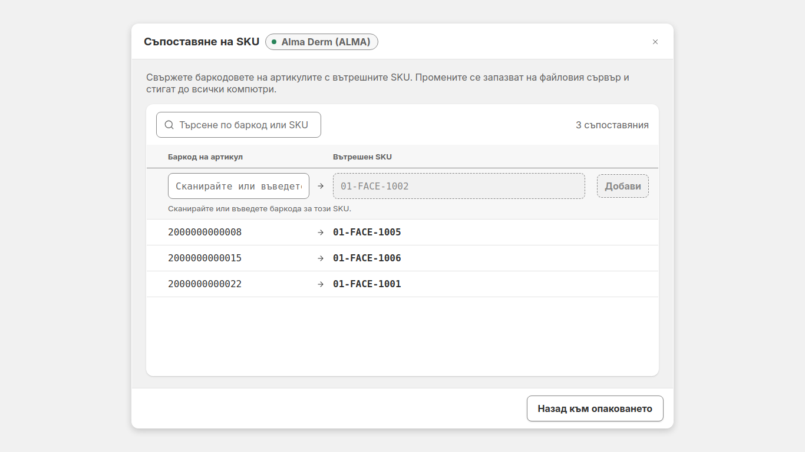

Помощ: натиснете ⋯ и после **Ръководство**, или натиснете **F1**, за да отворите това ръководство.
