# Packing Tool — User guide

## Part 1 — Daily work

### 1. What Packing Tool does

Packing Tool is where you pack the orders on a packing list. Fulfilment makes the packing lists for each client. You do not make them here.

The steps are:

1. Fulfilment makes the packing list and saves it in the session's `packing_lists` folder.
2. Packing Tool shows the list in **Sessions**.
3. You start the session. Packer Mode opens, and you scan each order and each item.
4. When the list is done, you end the session. Packing Tool saves a report.

### 2. Start the app and choose a worker

1. Open **Packing Tool**. The first screen says **Select your profile**.
2. Click your name. The card says **Opening…** for a moment, then the **Packing** page opens.
3. If your name is not listed, click **New worker**, type your name and click **Create**.
4. To close the app from this screen, click **Quit**. Once you are in, click **Switch worker…** at the bottom of the sidebar to choose another worker.

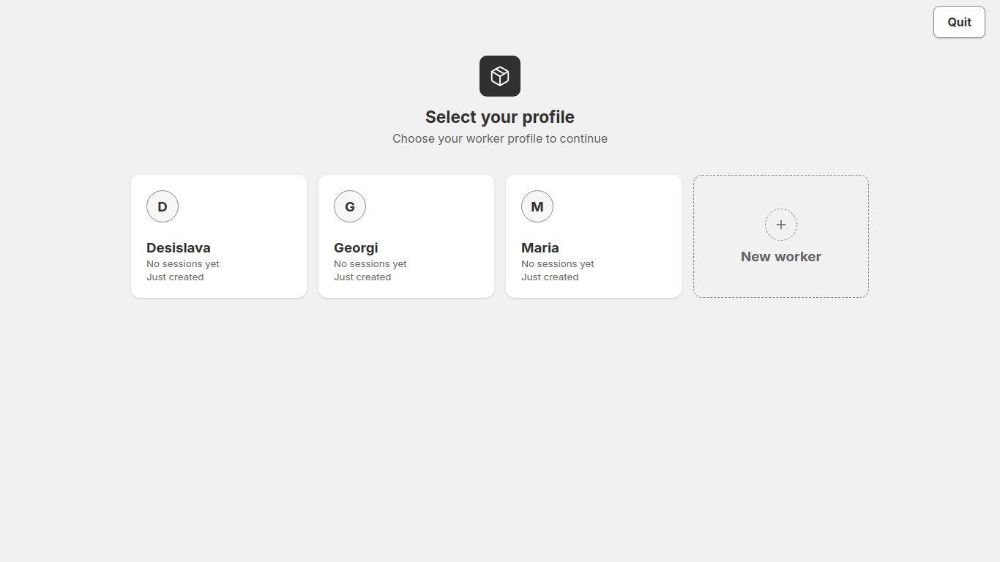

The bottom of the sidebar shows the connection, the language and the theme:

- **Server connected**, with the path of the file server, means this PC can reach the server. If it says **Server unreachable**, see section 12.
- Click **EN** or **BG** to change the language. Click **Light** or **Dark** to change the theme.

### 3. Open a session and start packing

A session is one packing list for one client.

1. Choose the client in the box at the top left of the window.
2. Click **Open session**. The **Sessions** page opens.
3. Find the session you need. A session that nobody has packed yet shows **Not started**.
4. Double-click the session. You can also click it and then click **Start packing** in the panel on the right.
5. Packer Mode opens and says **Scan an order barcode**.

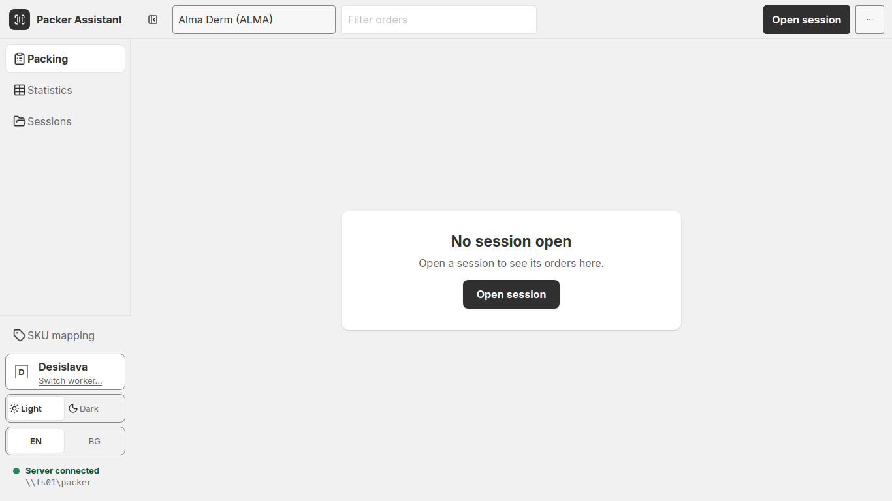

### 4. Pack an order

Packer Mode has one order open at a time. Scan the order first, then its items.

1. Scan the order barcode. The scanner types into the box **Order number or SKU**. If you type the number yourself, press Enter.
2. The order opens. Each item line shows its state, **Pending**, **Partial** or **Complete**, and how many units are packed.
3. Scan the barcode of each item. Each scan packs one unit. The banner says what happened, for example **01-FACE-1006 confirmed — 1 of 1 packed**.
4. When every line is complete, the banner says **Order 100002161 packed. Scan the next order.** Scan the next order.
5. The dot beside the box says **Ready to scan**. It says **Scanner disabled** when scanning is paused, for example while a question is open.

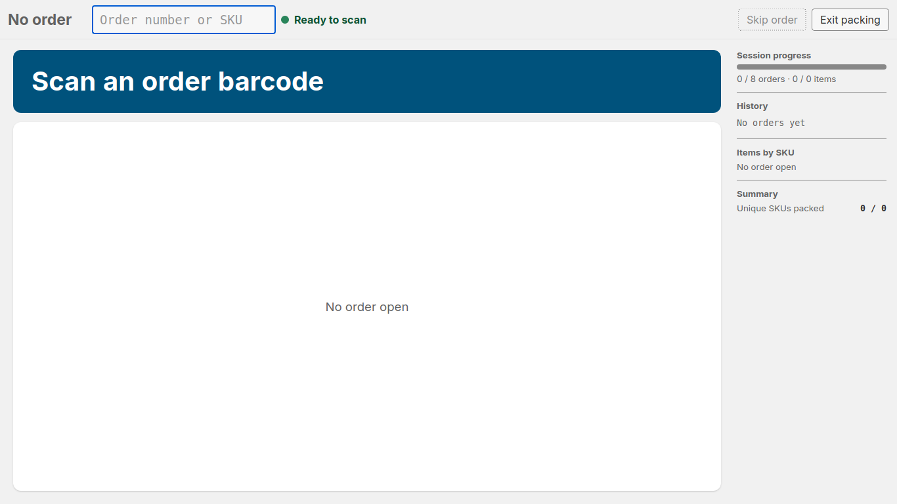

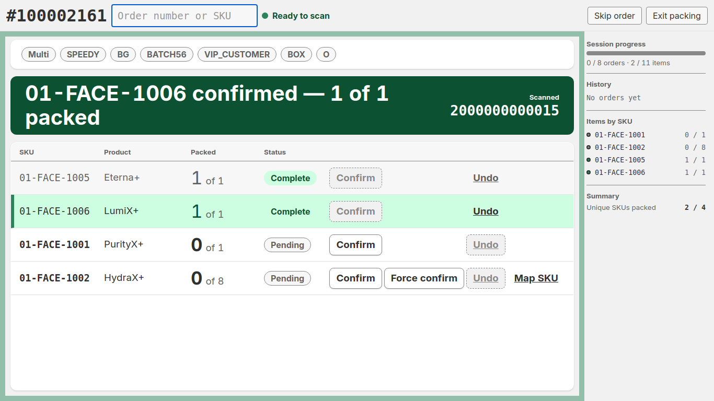

### 5. Confirm by hand, undo, and Force confirm

Some items cannot be scanned. Use the buttons at the end of the item's line.

- **Confirm** packs one unit without a scan. Use it only when the barcode cannot be scanned.
- **Undo** takes one unit back. It is dimmed when nothing is packed on that line.
- **Force confirm** packs all the remaining units of the line at once. It appears only on lines with more than 5 units. The app asks first, with the question **Force confirm** and the number of units. Click **Force confirm** to agree, or **Cancel** to stop. The scanner is off until you answer. The app says it cannot be undone.

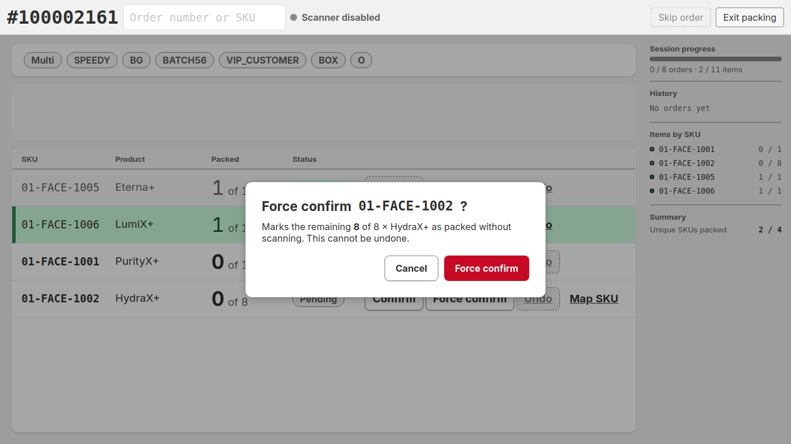

> **Important:** Use **Force confirm** only when the units are really in the order. You cannot take them back.

A **Map SKU** button on a line means no barcode is mapped to that SKU yet. See Part 2, "Map a SKU from Packer Mode".

### 6. Extra and No match

Two warnings look alike, but they mean different things.

**Extra** means the item is in this order, but all of its units are already packed, and you scanned it again.

1. The banner says **Extra item scanned — keep it or remove it**. A yellow panel, **Extra items scanned**, lists the SKU with the word **Extra** and a count.
2. Click **Keep** if the unit really belongs in this order. Click **Remove** if you scanned it by mistake.
3. Each click clears one unit. The app keeps only the count, not which button you clicked.
4. The order does not close while an extra is left. The banner says **Review the extra items before this order can close**.

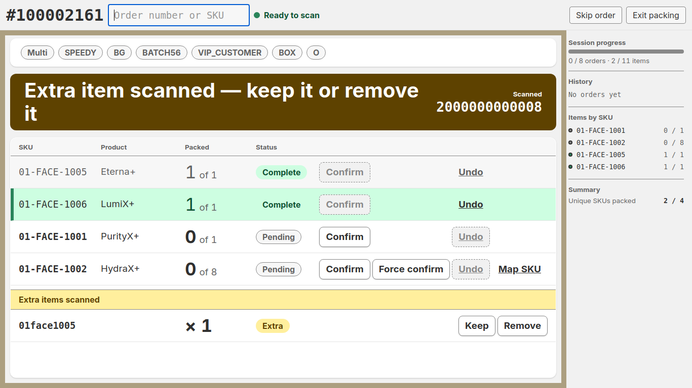

**No match** means the barcode is not an item of this order, and the SKU mapping does not turn it into one. The banner says **Unknown SKU 0000000000000 — scan again or map it**, and the scan appears as a row marked **No match** with the text **Not a SKU or barcode this client knows**.

1. Look at the product. If it is the wrong product, or a product from another order, set it aside.
2. If it is an item of this order, but its barcode is not in the mapping, click **Map barcode…** on the row. Add the barcode in Part 2, "Map a SKU from Packer Mode". Then scan the item again.

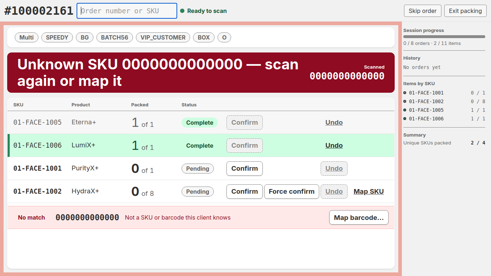

### 7. Skip an order and end the session

1. If an order cannot be finished now, click **Skip order**. The order goes into the history as **Skipped**. The units you already packed on it are kept, and you can scan the next order.
2. Scan a skipped order again when you can finish it. It is packed as usual.
3. When every order is packed, the panel says **Session complete** with the totals, for example "5 of 5 orders packed, 17 items.", and offers **End session** and **Exit packing**.
4. Click **End session**, or press Ctrl+E. Packing Tool saves a report in the session's `reports` folder and closes the session.

> **Note:** You can end a session before every order is packed. The session is then recorded as **Incomplete**.

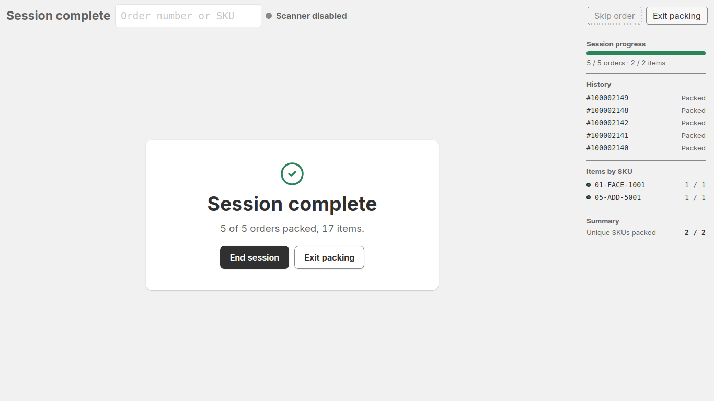

### 8. Leave, come back and take over

1. Click **Exit packing** to go back to the **Packing** page. The session stays open. The orders you packed are saved.
2. To return to Packer Mode, click **Start packing** at the top of the **Packing** page.
3. Only one session can be open on this PC. To open another, click **End session** first.
4. If another PC takes over the list while you are packing, the page says **This list is open on another PC**. The scanner stops. Click **Exit packing**. The orders you packed here up to now are saved.
5. A session shows **Stale** in the **Sessions** list when the PC that had it has not answered for two minutes. Double-click the session. The app asks **Take over** and the session name. Click **Take over and resume** only when the other PC has really stopped. Click **Cancel** to leave the session alone.

### 9. Statistics

**Statistics** shows the numbers for the open list.

- The top row shows **Orders**, **Completed**, **Items**, **Unique SKUs** and **Progress**.
- **By courier** shows how many orders are done for each courier.
- **SKU summary** lists each SKU with its **Total qty**, **Packed** and **Left**. The **Status** column says **Pending**, **Partial** or **Packed**.

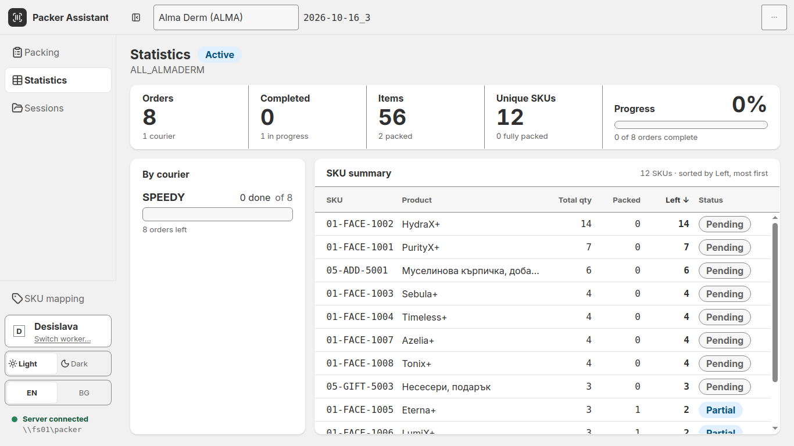

### 10. Sessions and session details

1. Click **Sessions** in the sidebar.
2. Use the tabs **All**, **Open**, **Finished** and **Abandoned** to filter the list. To find a session, type in **Search sessions**.
3. The **Status** column says **Not started**, **Active**, **Paused**, **Stale**, **Completed**, **Incomplete** or **Abandoned**. A session is **Completed** when every order is packed. It is **Incomplete** when it was ended before that.
4. The legend at the bottom says **Set by a person** for a solid dot, and **Inferred by the system** for a hollow dot.
5. Double-click a finished session, or select it and click **View details**. The details page shows the **Worker**, the **PC**, the times and the counts: **Orders packed**, **Items packed** and **Skipped orders**.
6. To save the details as an Excel file, click **Export Excel**. To go back, click **Back to Sessions**.

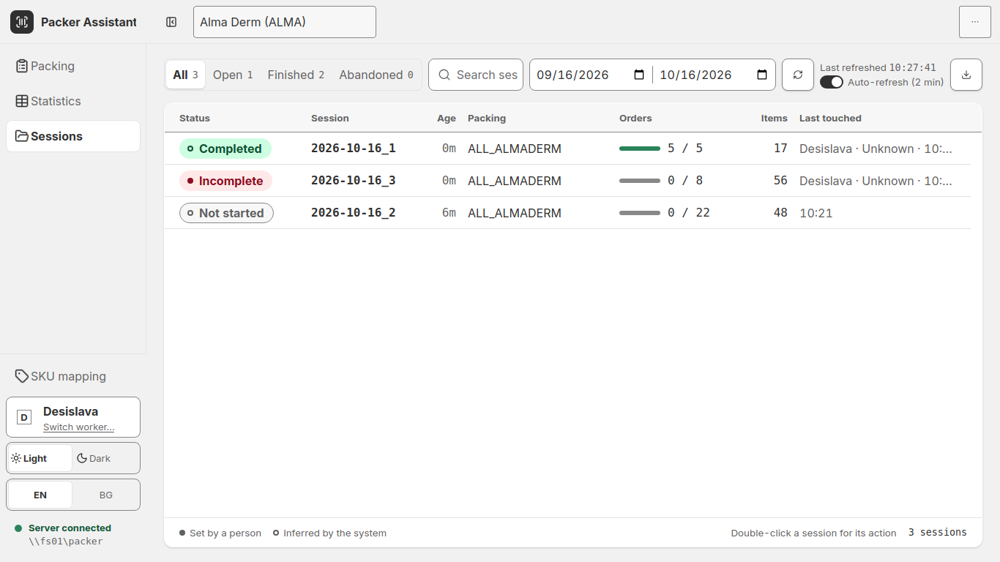

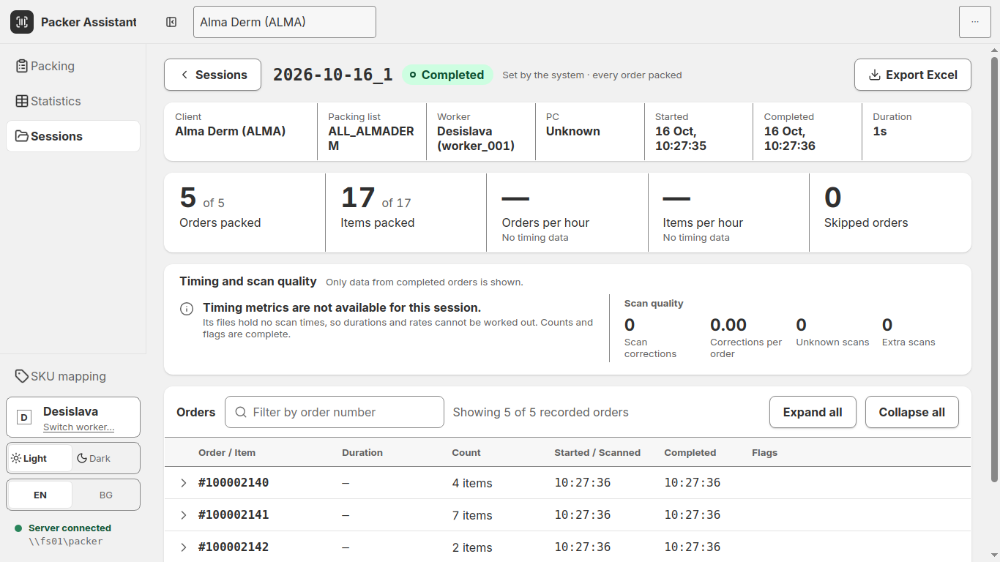

### 11. Language, theme and updates

- Click **EN** or **BG** at the bottom of the sidebar to change the language.
- Click **Light** or **Dark** to change the theme.
- Click ⋯ at the top right of the **Packing**, **Statistics** or **Sessions** page. The menu has **User guide**, **Server connection…**, **Check for updates…** and **Exit**.
- Press **Ctrl+1** for **Packing**, **Ctrl+2** for **Statistics** and **Ctrl+3** for **Sessions**.

### 12. When something goes wrong

Each message below is the text the app shows.

#### Server unreachable

The banner says **Server unreachable**, with the path of the server and the time it stopped answering. **Sessions cannot be opened or ended until it answers.**

1. Click **Retry**.
2. If it still fails, click ⋯, then **Server connection…**, and check the path.
3. If it still fails, ask the person who looks after the server.

#### Progress not saved — check the network

The banner **Progress not saved — check the network** means the app could not write your progress to the file server. **Scanning continues**, but the progress is not yet on the server.

1. Keep scanning, and check the network.
2. Tell the person who looks after the server if the banner stays. It goes away when the save works again.

#### This list is open on another PC

Another PC has taken over the list. Click **Exit packing**. The orders you packed here up to now are saved. See section 8.

#### Order 100002149 is already packed

The order was packed before. Do not pack it again. Scan the next order.

#### No order matches 123

The number you scanned is not in this packing list. Check it and scan it again.

#### 100002150 is an order. Finish or skip 100002161 first.

You scanned another order while one is open. Finish the open order, or click **Skip order**, and then scan the new one.

#### 2026-10-16_3 is open on this PC. End it before opening another.

Only one session can be open on this PC. Click **End session**, then open the other session.

---

## Part 2 — Setting up

### Workers

1. On the first screen, click **New worker**, type a name in the box and click **Create**. A name can be up to 24 characters.
2. The app refuses a name with these messages:
   - **Enter a name.** The box is empty.
   - **Use letters, numbers, spaces, dots, hyphens or apostrophes.** The name has other characters.
   - **There’s already a worker called Maria. Pick that card, or add a surname.** A worker with that name already exists. The comparison ignores capital letters.

### SKU mapping

A mapping links a product barcode to the internal SKU of the packing list. When you scan a mapped barcode, Packing Tool counts it as that SKU. The mappings are saved on the file server, and every PC uses them.

1. Click **SKU mapping** at the bottom of the sidebar.
2. Click **Add mapping**. Scan or type the product barcode in **Scan or type barcode**, then type the SKU in **Internal SKU**. Click **Add**.
3. To change a mapping, click the pencil icon, **Edit**. To remove one, click the trash icon, **Delete**, and confirm.
4. Use **Search barcode or SKU** to find a mapping.
5. Click **Save**. The page says **Saved. Every PC now uses these mappings.** Until you save, the page shows **Unsaved:** with the number of changes.
6. To drop your changes and load the copy on the server, click **Reload from server**, then **Discard and reload**.
7. To leave with unsaved changes, click **Cancel**. The app asks **Discard unsaved changes?**. Click **Keep editing** to stay, or **Discard** to leave.

If the barcode is already mapped to another SKU, the page says **This barcode already maps to** that SKU, and does not add it.

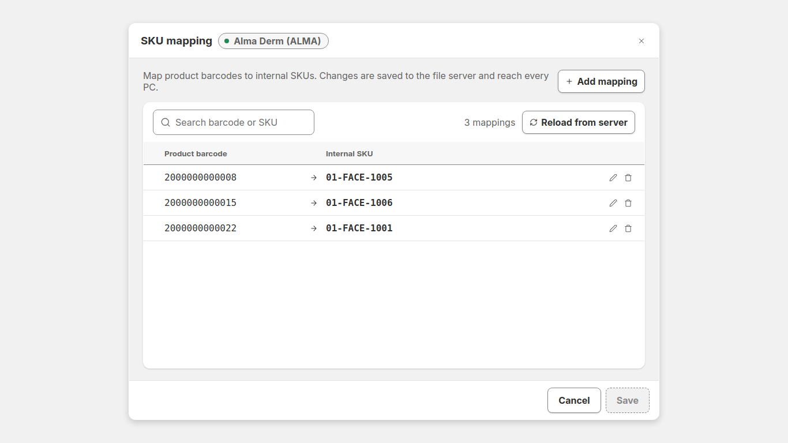

If the file server cannot be reached, the page shows **Couldn’t save to the file server.** Your changes stay on the page. Click **Try again**. If the list cannot be read, the page says **Couldn’t load the mappings.** Click **Retry**.

### Map a SKU from Packer Mode

Use this when a scan has no mapping. The page opens over Packer Mode, and the add is saved at once.

1. On an item line with a **Map SKU** button, click it. The SKU is filled in and cannot be changed. Scan or type the product barcode, then click **Add**.
2. On a **No match** row, click **Map barcode…**. The barcode is filled in and cannot be changed. Type the SKU, or pick it from the lines below. If the SKU is not on this order, the page says **Not on this order. Pick one of the lines below.**
3. Click **Back to packing** to leave without a change.

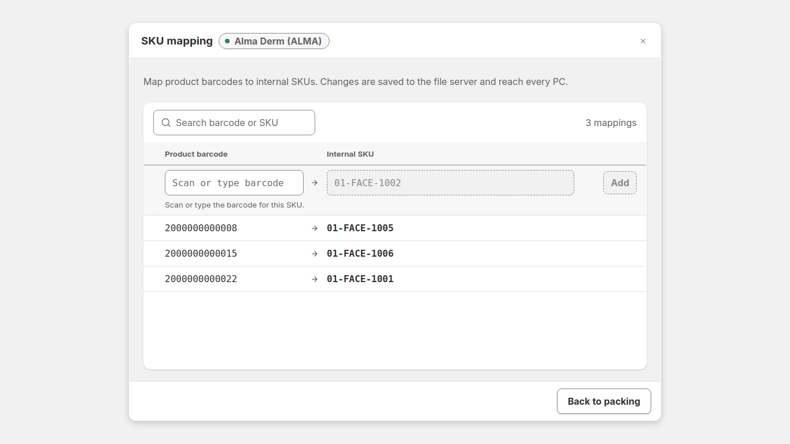

Getting help: click ⋯ and then **User guide**, or press **F1**, to open this guide.
